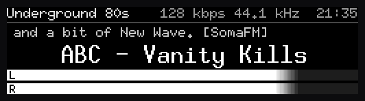
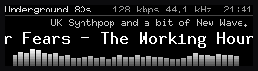
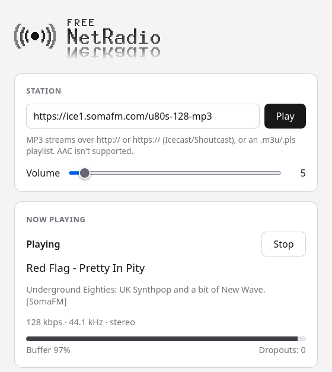
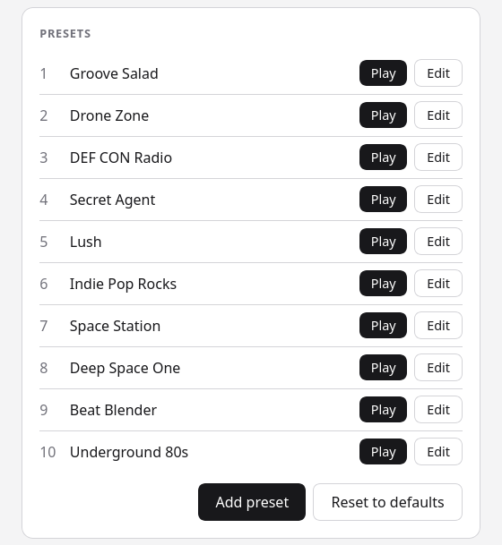
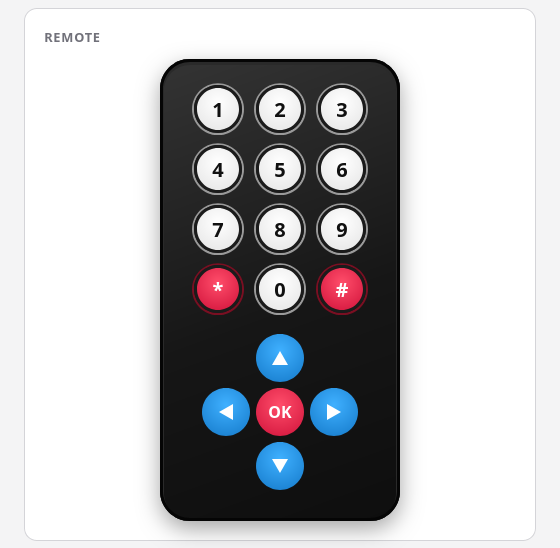
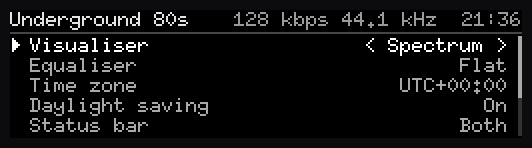
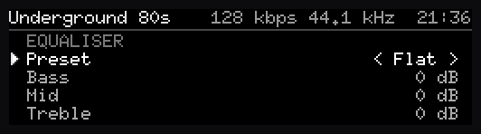
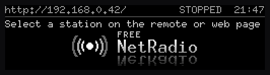
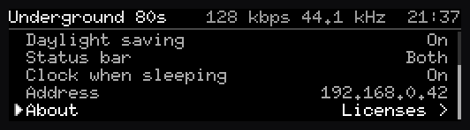

<div align="center">
<picture>
  <source media="(prefers-color-scheme: dark)" srcset="docs/logo-white.svg">
  <source media="(prefers-color-scheme: light)" srcset="docs/logo-black.svg">
  
</picture>
</div>

# FreeNetRadio

An internet radio you can build yourself: a controller dev board, a DAC chip , an IR receiver and a small OLED screen turn into a standalone radio that plays web streams, with no computer or phone needed once it's running.

<div align="center">
<table width="100%"><tr><td width="50%" align="center" valign="top"><br><sub>VU meters</sub></td><td width="50%" align="center" valign="top"><br><sub>Spectrum analyser</sub></td></tr></table>
</div>

Plug in an Ethernet cable and power, and it plays. Change stations with a cheap infrared remote or from any browser on your network. It remembers your last station and volume, and keeps up to 99 presets.

## What it does

- **Plays internet radio:** MP3 streams over `http://` and `https://`, including `.m3u` and `.pls` playlist links. It shows the station name and the current song title.
- **Looks good:** a 256×64 OLED shows the station, the audio format and a clock, with stereo VU meters or a spectrum analyser (or both, alternating).

- **Sounds the way you like:** volume, mute, and an equaliser with presets plus bass, mid and treble.
- **Controlled from anywhere in the house:** open the radio's address in a browser to pick stations, edit presets, set the volume or press the buttons on a virtual remote.

<div align="center">
<table width="100%"><tr><td width="33%" align="center" valign="top"><br><sub>Play and volume</sub></td><td width="33%" align="center" valign="top"><br><sub>Presets</sub></td><td width="33%" align="center" valign="top"><br><sub>The virtual remote</sub></td></tr></table>
</div>

- **Or use the remote:** a common 17-key infrared remote. Type a preset number, step through stations, change the volume, mute, enter and navigate menus.
- **A settings menu on the screen:** press `#` on the remote.

<div align="center">
<table width="100%"><tr><td width="50%" align="center" valign="top"><br><sub>Settings</sub></td><td width="50%" align="center" valign="top"><br><sub>Equaliser</sub></td></tr></table>
</div>

- **Rests nicely:** when stopped it shows its logo, then dims after a few seconds and can show the time.

<div align="center">
<table width="100%"><tr><td width="50%" align="center" valign="top"><br><sub>Stopped</sub></td><td width="50%" align="center" valign="top"><br><sub>After 10s idle: dimmed, optionally with the clock</sub></td></tr></table>
</div>

- **Looks after itself:** it sets its clock from the internet, reconnects if a stream or the network drops, and starts where you left off after a power cut.
- **Open source, with the credits on the device:** Settings → About (and the **About & licenses** button on the web page) shows the repository, the license and every open source library used.

<div align="center">
<table><tr><td align="center" valign="top"><br><sub>Settings → About</sub></td></tr></table>
</div>

## What you need

### Parts list

| # | Part | Notes |
|---|---|---|
| 1 | **WCH CH32V307V-EVT-R1** development board | The brain. It has the Ethernet port and a USB programmer built in. |
| 2 | **PCM5102A** I2S DAC module | Turns the digital audio into an analogue signal. A "PCM5102A" breakout board with a 3.5 mm line-out jack is the easiest. |
| 3 | **SSD1322 256×64 OLED** module | The display. Make sure it's 256×64 pixels with 4-bit greyscale, and that the configuration solder pads on the back are set for **4-wire SPI**. Some modules ship configured for a different interface (parallel or I2C), so check the board's silkscreen or datasheet. |
| 4 | **VS1838B infrared receiver** and a **17-key NEC remote** | Usually sold together as a "remote + receiver kit". |
| 5 | Ethernet cable and a **10/100/1000** switch or router port | The board's network chip is 10 Mbit. A multi-gig (2.5G/10G) port may refuse to link. |
| 6 | USB cable | Powers the board and programs it. |
| 7 | Jumper wires (female–female, or whatever suits your boards) | About 18 connections, listed below. |
| 8 | Amplified speakers, an amplifier or headphones | The DAC gives a line-level signal, not enough to drive speakers directly. |

On your computer you also need [Rust](https://rustup.rs), and [`wlink`](https://github.com/ch32-rs/wlink) (`cargo install wlink`) to flash the board.

### Wiring

| From | To (board pin) |
|---|---|
| DAC **BCK** | PB13 |
| DAC **LCK** (LRCK) | PB12 |
| DAC **DIN** | PB15 |
| DAC **SCK**, **FMT** | GND |
| DAC **XSMT** | 3V3 (if your module has this pin) |
| DAC **VIN** / **GND** | 3V3 (or 5V) / GND |
| OLED **SCLK (D0)** | PA5 |
| OLED **SDIN (D1)** | PA7 |
| OLED **CS** | PA4 |
| OLED **D/C** | PA3 |
| OLED **RES** | PA2 |
| OLED **VCC** / **GND** | 3V3 / GND |
| IR receiver **S** (signal) | PB10 |
| IR receiver **+** / **−** | 3V3 / GND |

Take care with the exact pin labels on your own modules: they vary between makers.

### Build and flash

1. **One-time chip setup.** The CH32V307 splits its memory between fast flash and RAM, and the radio needs a different split from the factory one. The small [`ram-split`](tools/ram-split) tool in this repository does this once: with the board connected, run `cargo run --release` inside `tools/ram-split`, then come back here (details in [TECHNICAL.md](TECHNICAL.md#one-time-setup)).
2. **Build and flash:**
   ```sh
   cargo build --release
   wlink flash target/riscv32imfc-unknown-none-elf/release/freenetradio
   ```
   The first build downloads the right Rust toolchain by itself.
3. **Use it.** Plug in Ethernet. The radio gets an address from your router and shows it on screen when stopped. Open `http://<that address>/` in a browser, paste a stream link and press Play. Or use the remote.

### The remote

| Button | What it does |
|---|---|
| ▲ / ▼ | Volume up / down (hold to repeat) |
| `*` | Mute / unmute |
| ◀ / ▶ | Previous / next preset |
| OK | Play / stop |
| `0`–`9` | Jump to a preset number (one or two digits) |
| `#` | Open or close the settings menu |

In the settings menu, ▲/▼ pick a row, ◀/▶ change it, and OK goes in or out of a submenu.

## AI disclaimer

AI was used to build this project, specifically mostly Claude Sonnet 5.5 Medium with a little Claude Opus 5.5 Medium. Typically, I would not rely solely on AI to build a project, however the deep technical nature of this project, my unfamiliarity with Rust or embedded development and a desire for a working PoC for a cool radio was what brought me to the decision that I wanted to give AI a shot with this.

So why am I placing it under license? Why do I think I deserve to do that? You're welcome to disagree with that choice, however I have decided to do so because I have put many hours into this personally identifying issues, testing, coming up with feature ideas and also deciding the interface design.

The UI is entirely of my own design and is what I think makes the radio look the part, so I take full credit for the structure if not for the implementation.

At heart I am a web, service and desktop developer, and therefore I do know the ins and outs of what it means to build a safe and reliable product. This product is NOT that. Do not rely on this product in a secure network to be safe and free of bugs or security vulnerabilities.

## License

FreeNetRadio is released under the [MIT License](LICENSE). It uses many open source libraries, each under its own license: see [LICENSES.md](LICENSES.md) for the full list, with authors and licenses. The same list is shown on the radio itself (Settings → About) and in the web interface (**About & licenses**).

FreeNetRadio is an independent project. The stations built in are public streams from [SomaFM](https://somafm.com), which isn't affiliated with this project; stream URLs you add belong to their operators. WCH, CH32, Embassy and the other names used here belong to their owners.
